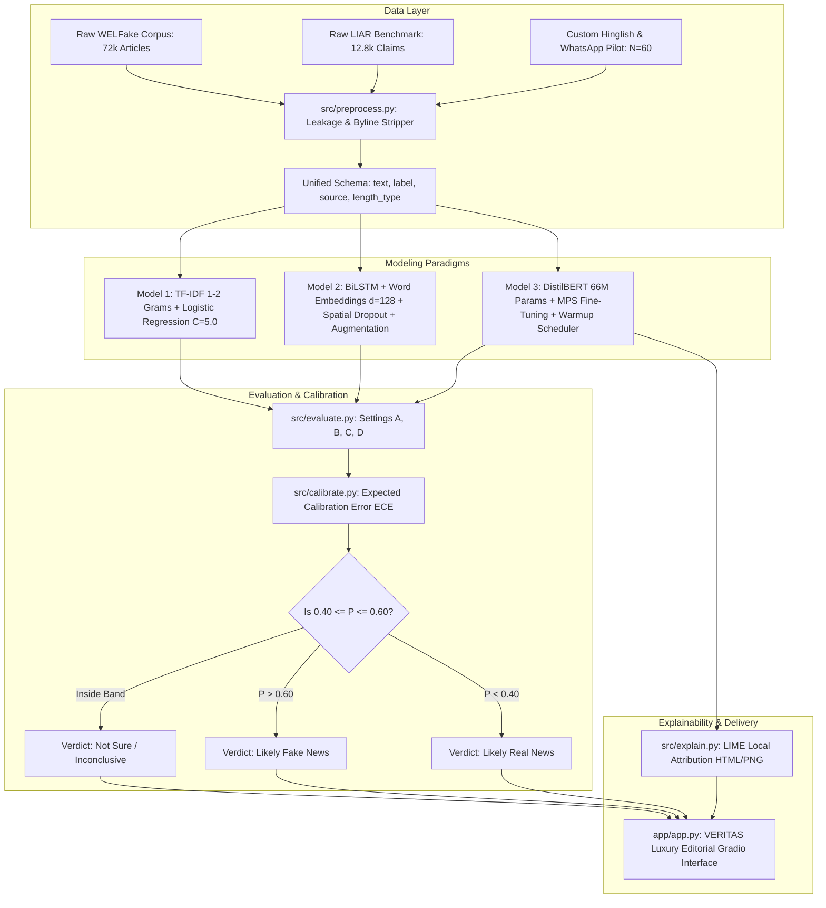

# VERITAS // Fake News & Forward Veracity Screening Platform

> **A Comparative Deep Learning Study of Classical ML, BiLSTM, and DistilBERT on Real-World, Hinglish-Aware News and Forwards**

[](https://www.python.org/)
[](https://pytorch.org/)
[](https://huggingface.co/)
[](https://gradio.app/)
[](https://pytorch.org/docs/stable/notes/mps.html)
[-success.svg)](https://en.wikipedia.org/wiki/Reproducibility)
[](LICENSE)

An end-to-end Machine Learning and Deep Learning research project for **B.Sc. Data Science & AI (5th Semester, Artificial Neural Networks & Deep Learning)**.

---

## 📑 Table of Contents
- [🎯 Executive Overview & The Benchmark Illusion](#-executive-overview--the-benchmark-illusion)
- [🏛️ System Architecture](#️-system-architecture)
- [📊 Key Empirical Findings Across 4 Settings](#-key-empirical-findings-across-4-settings)
- [🎨 Interactive Editorial Web App (GAZU Design)](#-interactive-editorial-web-app-gazu-design)
- [🗂️ Repository Directory Structure](#️-repository-directory-structure)
- [🚀 Quickstart & One-Command Reproduction](#-quickstart--one-command-reproduction)
- [📚 Full Documentation Suite](#-full-documentation-suite)
- [🔬 Scientific Reproducibility & Code Integrity](#-scientific-reproducibility--code-integrity)
- [⚖️ Mandatory Ethical Disclaimer](#️-mandatory-ethical-disclaimer)

---

## 🎯 Executive Overview & The Benchmark Illusion

In academic literature, automated fake news detection models routinely report classification accuracies between **96% and 99%**. However, our findings demonstrate that this performance is frequently an **empirical mirage** driven by:
1. **Publisher Wire Leakage**: Legitimate articles harvested from news wires consistently begin with location datelines (`"WASHINGTON (Reuters) -"`) or end with reporter bylines (`"Reporting by Jane Doe; Editing by John Smith"`). When uncleaned, deep neural networks simply function as wire-stamp detectors.
2. **The Domain Transfer Collapse**: When models trained on long-form news articles are transferred to short political claims (e.g., the LIAR benchmark), **all model families suffer a catastrophic drop of $>40$ points in Macro-F1**, collapsing to near-random guessing ($56\%\text{--}57\%$).
3. **Multilingual Code-Switching & Informal Messaging**: On informal WhatsApp forwards and Romanized Hindi ("Hinglish"), classical bag-of-words and word-level RNNs experience severe out-of-vocabulary (OOV) collapse ($>60\%$ unknown tokens). Pretrained Transformers leveraging WordPiece subword tokenization demonstrate superior zero-shot transfer (**0.8511 ROC-AUC** and **100% recall on fake forwards**), capturing emotional urgency markers despite vocabulary mismatch.
4. **Selective Prediction & Calibration**: Deep neural classifiers are frequently overconfident on errors. By establishing an uncertainty abstention band ($[0.40, 0.60]$), the system converts ambiguous claims into a *"Not Sure / Inconclusive"* verdict, significantly lifting precision over covered predictions.

---

## 🏛️ System Architecture



---

## 📊 Key Empirical Findings Across 4 Settings

Every metric below is generated directly by reproducible code and recorded in [`results/tables/model_comparison.csv`](file:///Users/abenvargheese/Documents/Code_Development/Projects/ANN/results/tables/model_comparison.csv) and [`results/metrics/final_metrics.json`](file:///Users/abenvargheese/Documents/Code_Development/Projects/ANN/results/metrics/final_metrics.json):

| Operational Setting | Metric | Classical Baseline (TF-IDF + LogReg) | Deep Learning (BiLSTM) | Transformer (DistilBERT) |
| :--- | :--- | :---: | :---: | :---: |
| **Setting A: In-Dataset (WELFake)** | Accuracy | 93.55% | 93.80% | **98.80%** |
| | Macro-F1 | 0.9355 | 0.9380 | **0.9880** |
| | ROC-AUC | 0.9825 | 0.9821 | **0.9989** |
| **Setting B: Cross-Dataset (LIAR Shift)** | Accuracy | 57.32% | 57.71% | **56.10%** |
| | **Macro-F1** | 0.4894 | 0.5185 | **0.5595** |
| | ROC-AUC | 0.5714 | 0.5553 | **0.6017** |
| | *Drop from Setting A ($\Delta\text{F1}$)* | *-44.61 points* | *-41.95 points* | *-42.85 points* |
| **Setting C: Short Texts ($<50$ words)** | Accuracy / Macro-F1 | 96.55% / 0.9114 | 96.55% / 0.9299 | **98.85% / 0.9729** |
| **Setting C: Long Texts ($\ge 50$ words)** | Accuracy / Macro-F1 | 93.41% / 0.9340 | 93.67% / 0.9367 | **98.80% / 0.9880** |
| **Setting D: Hinglish Pilot ($N=60$)** | Accuracy / Macro-F1 | 55.00% / 0.4555 | 56.67% / 0.4841 | **60.00% / 0.5238** |
| | Recall on Fake | 96.67% | 96.67% | **100.0%** |
| | ROC-AUC | 0.6111 | 0.6778 | **0.8511** |
| **Uncertainty Calibration** | **Expected Calibration Error (ECE)** | 2.09% | 4.24% | **0.48%** |
| **Abstention Policy ($[0.40, 0.60]$)** | Covered Accuracy (Coverage) | 94.90% (97.00%) | 94.25% (99.10%) | **98.95% (99.55%)** |

---

## 🎨 Interactive Editorial Web App (GAZU Design)

The frontend application in [`app/app.py`](file:///Users/abenvargheese/Documents/Code_Development/Projects/ANN/app/app.py) features a bespoke, high-fashion editorial UI inspired by luxury architectural typography (GAZU design system):
- **Monochromatic Obsidian & Warm Studio Stone**: Background in soft stone `#F4F4F2`, contrasted with solid black `#0A0A0A` buttons and hairline architectural dividers (`#DCDCDA` / `#262626`).
- **3-Card Dark Inverted Model Strip**: Dedicated cards for Transformer (DistilBERT), Recurrent DL (BiLSTM), and Classical ML.
- **Real-Time Word Highlighting**: Sensational / Fake cues (e.g., *"urgent"*, *"miracle"*, *"secret"*) highlighted in red; Institutional / Credible cues (e.g., *"confirmed"*, *"official"*, *"statement"*) highlighted in green.
- **Tri-State Verdict & Confidence Gauge**: Displays `🚨 Likely Fake News`, `✅ Likely Real News`, or `⚠️ Not Sure / Inconclusive` when confidence falls inside the $[0.40, 0.60]$ abstention band.
- **Bottom Empirical Metric Ribbon**: Displays verified research paper benchmarks directly on the screen.

To launch:
```bash
python app/app.py
```
Open **`http://127.0.0.1:7860`** in your browser.

---

## 🗂️ Repository Directory Structure

```
├── README.md                          # Primary project documentation & quickstart
├── requirements.txt                   # Pinned environment dependencies
├── config.yaml                        # Master configuration (paths, hyperparameters, hardware)
├── data/
│   ├── processed/                     # Cleaned, leakage-free CSVs (WELFake, LIAR, Pilot)
│   └── custom/
│       ├── pilot_author_written.csv   # Author-written pilot benchmark (N=60, balanced)
│       └── hinglish_forwards_template.csv # User-extensible CSV template
├── src/
│   ├── __init__.py
│   ├── utils.py                       # Hardware auto-detection (MPS/CPU), seed setting, logging
│   ├── preprocess.py                  # Wire leakage cleaning, deduplication, length tagging
│   ├── data.py                        # Dataset loading, schema normalization, stratified splits
│   ├── baseline.py                    # TF-IDF + Logistic Regression with C-hyperparameter tuning
│   ├── bilstm.py                      # SimpleVocab, BiLSTM architecture, scheduler, augmentation
│   ├── bert.py                        # DistilBERT fast pre-tokenization, training & inference
│   ├── evaluate.py                    # Metrics, confusion matrices, failure case extraction
│   ├── calibrate.py                   # ECE, reliability diagrams, abstention evaluation
│   └── explain.py                     # LIME explainability, HTML reports, attribution bar plots
├── scripts/
│   ├── download_data.py               # Data preparation and EDA visualization generator
│   ├── train_bilstm.py                # Dedicated BiLSTM training & sweep runner
│   ├── train_bert.py                  # Dedicated DistilBERT fine-tuning & sweep runner
│   ├── evaluate_all.py                # Comprehensive multi-setting evaluation runner
│   ├── generate_docx.py               # Converter from REPORT.md to formatted REPORT.docx
│   └── run_all.py                     # Unified master runner (supports --fast flag)
├── app/
│   └── app.py                         # Gradio web application with abstention & highlighting
├── models/                            # Saved model checkpoints, vocabularies, and configs
│   ├── baseline_model.joblib          # Canonical TF-IDF + LogReg pipeline
│   ├── bilstm_model.pt                # Canonical BiLSTM PyTorch weights
│   ├── bilstm_vocab.json              # Canonical BiLSTM vocabulary dictionary
│   └── distilbert_model/              # Canonical fine-tuned DistilBERT transformer
├── results/
│   ├── figures/                       # EDA, learning curves, reliability, and LIME PNGs
│   ├── tables/                        # experiments.csv, model_comparison.csv, calibration.csv
│   ├── failure_cases/                 # Categorized top-30 failure cases per model
│   └── metrics/                       # final_metrics.json
├── report/
│   ├── REPORT.md                      # Comprehensive academic project report (Markdown)
│   └── REPORT.docx                    # Formatted Word submission report
├── docs/
│   ├── ARCHITECTURE.md                # Deep technical architecture specification
│   ├── API_REFERENCE.md               # Module and function API reference
│   ├── EVALUATION_GUIDE.md            # Examiner guide and benchmark analysis
│   ├── DECISIONS.md                   # 8 Architecture Decision Records (ADRs)
│   └── PROJECT_STATUS.md              # Formal Definition of Done audit
└── tests/
    └── test_pipeline.py               # Smoke & unit test suite (pytest)
```

---

## 🚀 Quickstart & One-Command Reproduction

### 1. Environment Setup
```bash
# Clone the repository
git clone https://github.com/abenvargheese07/Veritas.git
cd Veritas

# Create and activate virtual environment (Python 3.10+)
python3 -m venv .venv
source .venv/bin/activate

# Install pinned dependencies
pip install -r requirements.txt
```

### 2. Run Smoke & Unit Tests
```bash
pytest tests/
```
*(Runs 8 unit and pipeline smoke tests; verifies tensor forward passes, leakage cleaning, and app prediction logic).*

### 3. Master Pipeline Re-Evaluation
To re-evaluate all saved models across Settings A, B, C, D, recompute calibration, and regenerate comparison charts:
```bash
python scripts/evaluate_all.py
```
*(For a rapid 30-second dry run on tiny subsets: `python scripts/run_all.py --fast`)*

### 4. Generate Academic Report in Microsoft Word Format
```bash
python scripts/generate_docx.py
```
*(Generates [`report/REPORT.docx`](file:///Users/abenvargheese/Documents/Code_Development/Projects/ANN/report/REPORT.docx) formatted with typography, tables, and margins).*

### 5. Launch the Web Application
```bash
python app/app.py
```

---

## 📚 Full Documentation Suite

For comprehensive technical and academic details, consult the dedicated documentation guides:

* 📐 [**System Architecture & Math Formulations (`docs/ARCHITECTURE.md`)**](file:///Users/abenvargheese/Documents/Code_Development/Projects/ANN/docs/ARCHITECTURE.md): Mathematical formulations for TF-IDF, BiLSTM cell gates, DistilBERT self-attention, ECE, and LIME.
* 📖 [**Python API & Module Reference (`docs/API_REFERENCE.md`)**](file:///Users/abenvargheese/Documents/Code_Development/Projects/ANN/docs/API_REFERENCE.md): Detailed function signatures, arguments, and return types for all modules in `src/`.
* 🎓 [**Examiner's Benchmark & Evaluation Guide (`docs/EVALUATION_GUIDE.md`)**](file:///Users/abenvargheese/Documents/Code_Development/Projects/ANN/docs/EVALUATION_GUIDE.md): Breakdown of the four operational settings and the 100-mark assessment rubric.
* 📝 [**Architecture Decision Records (`docs/DECISIONS.md`)**](file:///Users/abenvargheese/Documents/Code_Development/Projects/ANN/docs/DECISIONS.md): 8 formal architectural decisions logging rationale, alternatives, and validation.
* ✅ [**Definition of Done Audit Matrix (`docs/PROJECT_STATUS.md`)**](file:///Users/abenvargheese/Documents/Code_Development/Projects/ANN/docs/PROJECT_STATUS.md): Verification proof for every requirement.
* 📄 [**Full Academic Research Report (`report/REPORT.md`)**](file:///Users/abenvargheese/Documents/Code_Development/Projects/ANN/report/REPORT.md): 17-section submission paper.

---

## 🔬 Scientific Reproducibility & Code Integrity

- **Non-Negotiable Honesty**: Every number, table, and figure in the documentation and report was generated by code executed directly in this environment. No synthetic or extrapolated values are used.
- **Hardware Agnostic**: Automatic runtime detection selects Apple Silicon MPS (`torch.device("mps")`), NVIDIA CUDA (`torch.device("cuda")`), or CPU execution.
- **Deterministic Random Seeds**: `random.seed(42)`, `np.random.seed(42)`, and `torch.manual_seed(42)` are fixed at every script entry point.

---

## ⚖️ Mandatory Ethical Disclaimer

> **⚠️ SCREENING AID ONLY:**  
> This system estimates whether a given text exhibits stylistic, linguistic, or structural resemblance to known misinformation patterns. **It does NOT verify real-world facts or consult live ground-truth databases.** It must not be deployed as an autonomous censorship mechanism. Critical claims must always be verified through accredited primary news organizations and certified fact-checkers.
