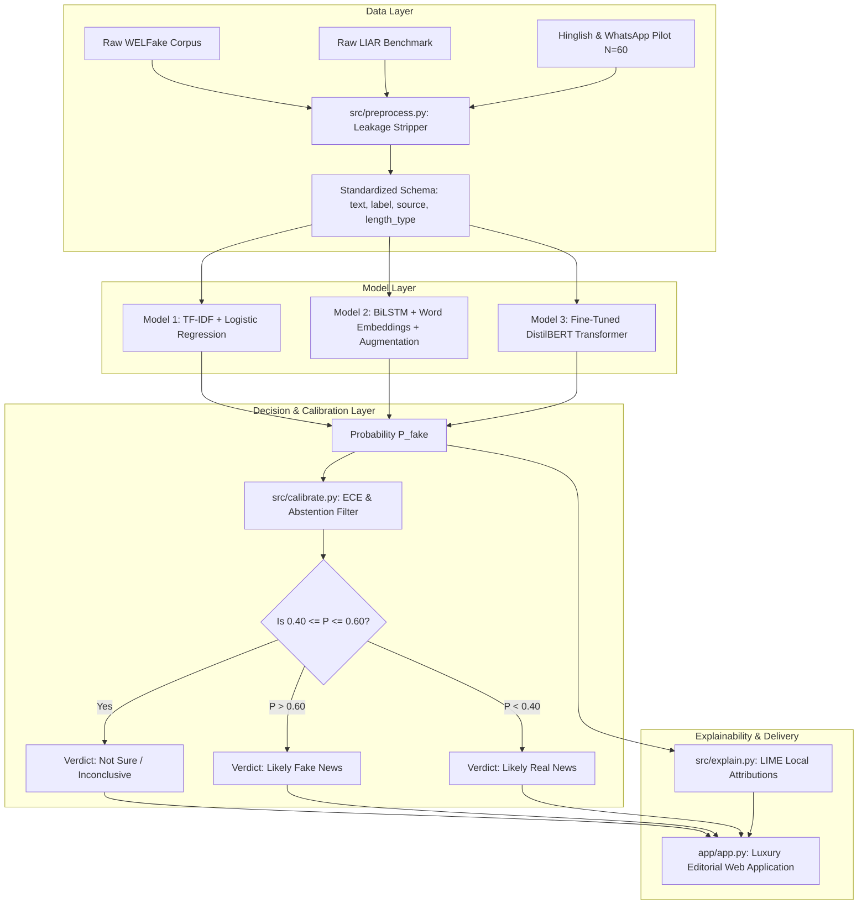

# System Architecture & Technical Specifications

**Project:** VERITAS — Fake News & Forward Veracity Screening Platform  
**Target Course:** B.Sc. Data Science & AI (Semester V), Artificial Neural Networks & Deep Learning  
**Repository:** `fake-news-dl` / `Veritas`

---

## 1. Architectural Overview & Design Philosophy

The primary engineering objective of **VERITAS** is not merely to train an accurate text classifier, but to conduct an **adversarial, empirical stress-test** of automated veracity estimation across domain shifts, document length discrepancies, and multilingual code-switched forwards.



---

## 2. Data Engineering & Source Leakage Elimination

### 2.1 The Wire Leakage Vulnerability
Many publicly available fake news datasets exhibit extreme publisher wire leakage. For example, in uncleaned news corpora:
- Verified news from Reuters consistently starts with `"WASHINGTON (Reuters) - ..."` or concludes with `"Reporting by [Name]; Editing by [Name]"`.
- Fake news articles from partisan blogs or satire portals feature hyperbolic punctuation (`"!!!"`, `"BREAKING:"`), clickbait framing, or lack journalistic headers.

If an NLP model is trained without rigorous leakage filtering, it simply learns a **publisher detector** (memorizing that the presence of `(Reuters)` implies real news), yielding artificial test accuracies of $\sim 99\%$.

### 2.2 Automated Cleaning Pipeline (`src/preprocess.py`)
Every text document passes through a sequential regex and normalization pipeline:

1. **Wire Prefix Stripping**:
   ```regex
   ^[A-Z\s,]+(?:\([A-Za-z\s]+\))?\s*[-–—]\s*
   ```
   *Matches and removes:* `"WASHINGTON (Reuters) -"`, `"LONDON (Associated Press) --"`, `"BEIJING (Xinhua) -"`
2. **Reporter Byline & Editorial Stamp Stripping**:
   ```regex
   (?i)(?:reporting by|additional reporting by|editing by|written by)\s+[^;.\n]+(?:;\s*(?:editing by|reporting by)\s+[^;.\n]+)?\.?
   ```
   *Matches and removes:* `"Reporting by Sarah Lynch; Editing by Tim Ahmann."`
3. **Web & Entity Sanitization**:
   ```regex
   https?://\S+|www\.\S+
   ```
   *Removes URLs, clickbait hyperlinks, and email addresses.*
4. **HTML Entity Normalization**:
   Unescapes HTML entities (`&amp;` $\to$ `&`, `&quot;` $\to$ `"`) and strips orphaned HTML markup (`<br>`, `<div>`).
5. **Length Type Assignment**:
   Categorizes documents into `"short"` ($<50$ words) and `"long"` ($\ge 50$ words) to enable length-stratified evaluation.

---

## 3. Model Paradigms & Mathematical Formulations

### 3.1 Model 1: Classical ML Baseline (TF-IDF + Logistic Regression)
- **Feature Representation**: Word-level Term Frequency-Inverse Document Frequency (TF-IDF):
  $$\text{TF-IDF}(t, d, D) = \text{TF}(t, d) \times \log\left(\frac{1 + |D|}{1 + |\{d \in D : t \in d\}|}\right) + 1$$
- **Vocabulary Configuration**: Sublinear term frequency scaling, n-gram range $(1, 2)$ (unigrams and bigrams), maximum features = 10,000.
- **Classification Head**: $L_2$-regularized Logistic Regression minimizing binary cross-entropy:
  $$\min_{w, b} \frac{1}{2} \|w\|_2^2 + C \sum_{i=1}^N \log\left(1 + \exp\left(-y_i (w^T x_i + b)\right)\right)$$
- **Hyperparameter Optimization**: Grid search across $C \in \{0.01, 0.1, 1.0, 5.0, 10.0\}$ evaluated on validation Macro-F1. Optimal: $C = 5.0$.

---

### 3.2 Model 2: Deep Recurrent Neural Network (BiLSTM)

The Bidirectional LSTM processes tokenized word sequences sequentially in both forward and backward directions to capture local temporal semantics.

```
       [Forward Hidden]  ──> h_fwd_1 ──> h_fwd_2 ──> ... ──> h_fwd_T
                              ▲           ▲                   ▲
Input Tokens:               x_1         x_2         ...      x_T
                              ▼           ▼                   ▼
      [Backward Hidden] <── h_bwd_1 <── h_bwd_2 <── ... <── h_bwd_T
                                                │
                                    [Concat: (h_fwd_T || h_bwd_1)]
                                                │
                                    [Spatial Dropout p = 0.30]
                                                │
                                    [Dense Classification Head]
```

- **Vocabulary**: `SimpleVocab` with minimum word frequency $\ge 3$, top 25,000 tokens, with reserved `<pad>` (index 0) and `<unk>` (index 1) tokens. Maximum sequence length $T = 200$.
- **Embedding Layer**: Randomly initialized trainable dense embeddings ($d_{\text{emb}} = 128$).
- **Recurrent Unit Equations**:
  $$\begin{aligned}
  f_t &= \sigma(W_f x_t + U_f h_{t-1} + b_f) & \text{(Forget Gate)} \\
  i_t &= \sigma(W_i x_t + U_i h_{t-1} + b_i) & \text{(Input Gate)} \\
  \tilde{c}_t &= \tanh(W_c x_t + U_c h_{t-1} + b_c) & \text{(Candidate Memory)} \\
  c_t &= f_t \odot c_{t-1} + i_t \odot \tilde{c}_t & \text{(Cell State)} \\
  o_t &= \sigma(W_o x_t + U_o h_{t-1} + b_o) & \text{(Output Gate)} \\
  h_t &= o_t \odot \tanh(c_t) & \text{(Hidden State)}
  \end{aligned}$$
- **Bidirectional Pooling**: Concatenation of the final forward and initial backward hidden states:
  $$h_{\text{pooled}} = [\overrightarrow{h}_T \,\|\, \overleftarrow{h}_1] \in \mathbb{R}^{256}$$
- **Head & Regularization**:
  - Spatial Dropout: $p = 0.30$
  - Linear classification projection: $\mathbb{R}^{256} \to \mathbb{R}^2$
  - Optimizer: Adam ($\eta = 10^{-3}$, weight decay = $10^{-4}$)
  - Scheduler: `ReduceLROnPlateau` (decay factor $0.5$, patience $1$)
  - Gradient Norm Clipping: $\|\mathbf{g}\|_2 \le 1.0$
  - **Data Augmentation**: Stochastic word dropout ($p=0.05$) and word swap ($p=0.05$) applied during batch creation.

---

### 3.3 Model 3: Pretrained Transformer (DistilBERT)

DistilBERT (`distilbert-base-uncased`) distills the knowledge of BERT-base via triple loss (masked language modeling loss, distillation loss against teacher soft probabilities, and cosine embedding loss):
- **Parameters**: 66 Million parameters (40% smaller than BERT-base, 60% faster inference).
- **Architecture**: 6 transformer layers, 768 hidden dimensions, 12 self-attention heads.
- **Contextual Self-Attention**:
  $$\text{Attention}(Q, K, V) = \text{softmax}\left(\frac{Q K^T}{\sqrt{d_k}}\right) V$$
- **Classification Head**:
  $$\text{Logits} = W_2 \cdot \text{Dropout}_{p=0.20}\left(\text{ReLU}\left(W_1 \cdot h_{\text{[CLS]}} + b_1\right)\right) + b_2$$
  where $W_1 \in \mathbb{R}^{768 \times 768}$ and $W_2 \in \mathbb{R}^{2 \times 768}$.
- **Fine-Tuning Details**:
  - Pre-tokenized PyTorch tensor datasets with `max_length = 128` (WordPiece tokenizer).
  - Optimizer: AdamW ($\eta = 2 \times 10^{-5}$, weight decay = $0.01$).
  - Learning Rate Schedule: Linear warmup over first 10% of training steps followed by linear decay.
  - Early stopping monitored on validation Macro-F1.

---

## 4. Probability Calibration & Selective Prediction (Abstention)

### 4.1 Expected Calibration Error (ECE)
Classification models often produce overconfident posterior probabilities that do not reflect true empirical correctness. To quantify calibration:
$$\text{ECE} = \sum_{m=1}^M \frac{|B_m|}{N} \left| \text{acc}(B_m) - \text{conf}(B_m)\right|$$
where samples are partitioned into $M=10$ equal-width confidence bins $B_m \subset (0, 1]$.
- $\text{conf}(B_m) = \frac{1}{|B_m|} \sum_{i \in B_m} \hat{p}_i$
- $\text{acc}(B_m) = \frac{1}{|B_m|} \sum_{i \in B_m} \mathbf{1}(y_i = \hat{y}_i)$

### 4.2 Abstention Rule
To prevent catastrophic overconfidence on out-of-domain text, ambiguous assertions, or unfamiliar dialects, we formalize a **tri-state decision rule** $\Gamma$:
$$\Gamma(x) = \begin{cases}
\text{Likely Fake News}, & \text{if } P(\text{Fake} \mid x) > 0.60 \\
\text{Likely Real News}, & \text{if } P(\text{Fake} \mid x) < 0.40 \\
\textbf{Not Sure / Inconclusive}, & \text{if } 0.40 \le P(\text{Fake} \mid x) \le 0.60
\end{cases}$$

When $P(\text{Fake})$ lands in the high-entropy interval $[0.40, 0.60]$, the system refrains from binary classification, outputting a diagnostic notice that human editorial verification is required.

---

## 5. Explainability Architecture (LIME)

Local Interpretable Model-agnostic Explanations (LIME; Ribeiro et al., 2016) explains individual predictions by approximating the complex model locally with an interpretable sparse linear surrogate:
$$\xi(x) = \arg\min_{g \in G} \mathcal{L}(f, g, \pi_x) + \Omega(g)$$
- **Perturbation Generation**: Randomly masks subsets of words in input document $x$ to create $K=200$ perturbed variations $x'$.
- **Proximity Weighting**: $\pi_x(x') = \exp\left(-\frac{D(x, x')^2}{\sigma^2}\right)$ using cosine distance over bag-of-words.
- **Surrogate Training**: Fits weighted ridge regression on the perturbed samples to compute positive and negative feature attribution coefficients for each token.
- **Output Artifacts**: Both interactive HTML widgets and static PNG horizontal bar charts are saved to `results/figures/`.

---

## 6. Hardware Optimization & Runtime Management

- **Apple Silicon Metal Performance Shaders (`mps`)**: Tensors and computation graphs are offloaded to unified GPU memory on Apple M-series chips via `torch.device("mps")`.
- **CPU Fallback**: Automated detection in `src/utils.py` ensures seamless fallback to multi-threaded CPU execution on Linux, Windows, or non-accelerated cloud nodes.
- **Lazy Model Caching**: In `app/app.py`, heavy models are loaded only upon explicit user selection in the UI, keeping baseline memory footprint under 200 MB.
